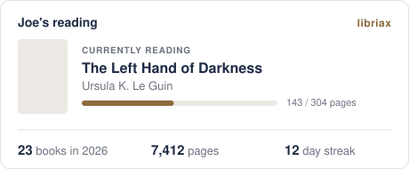

<p align="center">
  <a href="https://libriax.com"></a>
</p>

<h1 align="center">Libriax Reading Card</h1>

<p align="center">
  Your reading, live on your GitHub profile.
</p>

<p align="center">
  <a href="https://libriax.com"></a>
  <a href="https://github.com/libriax/reading-card/actions/workflows/ci.yml"></a>
  <a href="LICENSE"></a>
</p>

<p align="center">
  <picture>
    <source media="(prefers-color-scheme: dark)" srcset="docs/example-dark.svg">
    
  </picture>
</p>

## Add yours

**With Libriax.** Turn on **Public reading card** in your [Libriax](https://libriax.com) settings, then paste this into your profile README:

```markdown
[](https://libriax.com)
```

**With Goodreads.** Use the number from your public profile URL (`goodreads.com/user/show/12345678-name`):

```markdown
[](https://libriax.com)
```

Libriax cards also show your streak and how far through your book you are.

## Themes

Add `?theme=dark` for the Libriax night palette. The default is the day palette.

To match each visitor's GitHub theme:

```html
<picture>
  <source media="(prefers-color-scheme: dark)" srcset="https://card.libriax.workers.dev/libriax/YOUR_USERNAME?theme=dark">
  
</picture>
```

## How it works

```
README ──▶ GitHub image proxy ──▶ Worker ──▶ Libriax API / Goodreads RSS
           (caches 30 min)
```

- **GitHub fetches the card, not your visitors.** Its proxy caches it, so cards refresh about every 30 minutes.
- **The SVG is self-contained.** Images inside `` can't load anything, so the cover is embedded as base64 and text uses system fonts.
- **Errors still render.** A private profile or an outage gives a card with a message, never a broken image.

| File | Job |
| --- | --- |
| `src/lib.rs` | Routing, fetching, caching, embedding the cover |
| `src/card.rs` | Reading data in, SVG out. No I/O |
| `src/goodreads.rs` | Parses Goodreads shelf feeds |

## Develop

Needs Rust and Node.

```sh
cargo test                                       # unit tests
cargo run --example preview -- dark > card.svg   # render a sample card
npx wrangler dev                                 # run the Worker locally
```

Set `LIBRIAX_URL` in `wrangler.toml` to `http://localhost:5000` to work against a local Libriax.

Good first contributions: a new theme, a compact layout, a `?hide=` option, or a new source like StoryGraph or Open Library.

## Security

Found a vulnerability? Please don't open an issue. See [SECURITY.md](SECURITY.md).

Icons are from [Font Awesome Free](https://fontawesome.com) (CC BY 4.0).

<p align="center">
  <sub>Made by <a href="https://libriax.com">Libriax</a>, the reading tracker for people who like charts.</sub>
</p>
